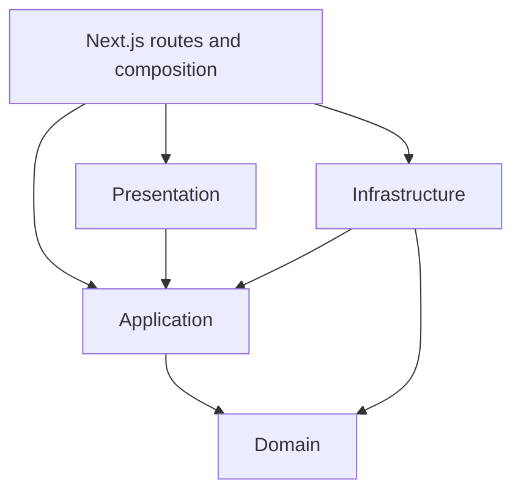

# Architecture baseline

`app` is the composition root and routing layer. `presentation` renders UI;
`application` declares use cases and ports; `domain` owns pure business rules;
`infrastructure` implements adapters. The inner layers never import frameworks.

The public site uses the validated static content adapter. CSS and system fonts avoid extra
network requests. The CRM and n8n laboratory run as local operator tools, not public routes.
See [production architecture](production-architecture.md) for the proposed deployment boundaries.
The architecture check is a baseline literal-import scan, not a formal dependency graph.
