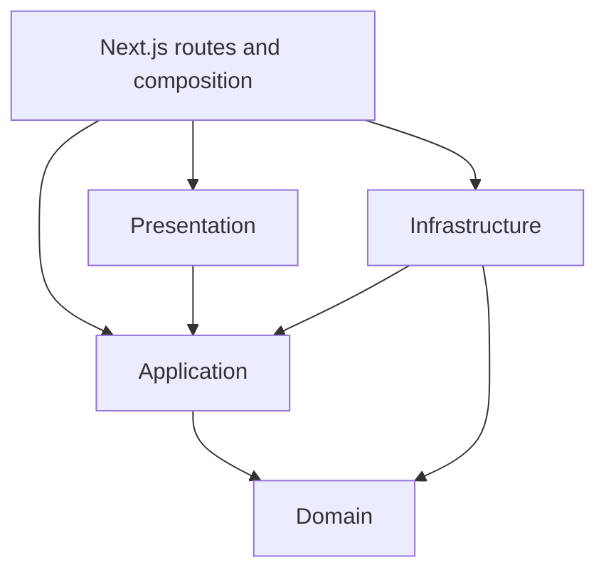

# Architecture baseline

`app` is the composition root and routing layer. `presentation` renders UI;
`application` declares use cases and ports; `domain` owns pure business rules;
`infrastructure` implements adapters. The inner layers never import frameworks.

The static content adapter can be replaced by Sanity after defining an async port.
No database or external APIs are necessary yet. CSS and system fonts avoid extra network requests.
The 3D engine, animations, CMS, n8n and booking belong to later sprints.
The architecture check is a baseline literal-import scan, not a formal dependency graph.
