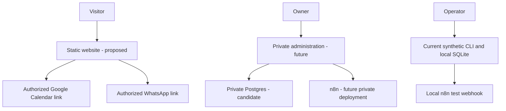

# Production architecture — Sprint 4.1

Status: proposed deployment target, not an active deployment.

## Decision

Separate the public, read-only corporate website from the private commercial
backend. Launch the public portfolio and authorized contact links first,
without any actual lead intake or public administration. Keep the local n8n
and SQLite laboratory synthetic and offline from public traffic. A later
authenticated backend will own real lead persistence and delivery.

The current Next.js server build remains the supported implementation.
A static-export proof of concept is the next implementation gate, not an
already-supported deployment mode.

## Hosting options reviewed on 2026-11-26

| Option | Role | Decision |
| --- | --- | --- |
| Cloudflare Pages Free | Static public site | Preferred candidate for zero hosting fees within quotas |
| Vercel Hobby | Personal noncommercial projects | Not approved for a commercial Genyx site |
| Vercel Pro | Managed Next.js alternative | Requires explicit budget approval |
| Supabase Free | Future private Postgres and Auth prototype | Candidate only; inactivity pausing and recovery limitations |
| Local n8n and SQLite | Synthetic operator laboratory | Keep local, no public tunnel |

Cloudflare documents free static asset traffic and 500 monthly Pages builds
on the Free tier. Its terms and account-specific constraints must be accepted
by the owner before deployment. The free tier is not a service-level guarantee.
No payment processing or card data is in scope. A purchased domain, email,
always-on compute and future data services may introduce costs.

Vercel Hobby is restricted to personal, noncommercial use. Do not use it to
advertise commercial services. Vercel remains a paid alternative if the owner
chooses it later. Supabase Free currently provides 500 MB database capacity
per project but can pause after a week of insufficient activity; production
backup and availability requirements must be reviewed separately.
n8n Community licensing permits internal business use subject to its terms;
do not sell hosted access or embed the editor for customers without reviewing
the applicable license. Local execution also requires a running host.

Sources:

- https://developers.cloudflare.com/pages/
- https://developers.cloudflare.com/pages/functions/pricing/
- https://www.cloudflare.com/terms/
- https://developers.cloudflare.com/pages/framework-guides/nextjs/deploy-a-static-nextjs-site/
- https://nextjs.org/docs/app/guides/static-exports
- https://vercel.com/docs/plans/hobby
- https://vercel.com/legal/terms
- https://supabase.com/pricing
- https://supabase.com/docs/guides/deployment/going-into-prod
- https://github.com/n8n-io/n8n/blob/master/LICENSE.md

## Trust boundaries

The public build must never include local CRM storage, test tokens or operator
scripts. Calendar and WhatsApp configuration is intentionally public because
the resulting URLs appear in rendered HTML. Do not use public environment
variables for secrets. Deploy no API routes until a separate security review.

## Repository guard

The architecture check now scans the public source tree for new unreviewed
page/layout/route files, request interception, direct imports of private CRM
or operator modules, and selected private credential references. The separate
local CRM subtree is excluded. Tests exercise representative failures.
This source-level guard is defense in depth, not a complete information-flow
or security analysis. It does not certify build output or detect all possible
secret names or indirect runtime behavior.

## Static export feasibility gates

Next.js static exports require adaptations not yet implemented here:

1. Add an explicit export profile while preserving the Node build and CI.
2. Replace the entry redirect with an appropriate static entry and provider
   redirect. Configure equivalent security headers at the hosting layer.
3. Resolve the currently empty dynamic product detail route without inventing
   available products. Generate only published case and service paths.
4. Validate direct visits, client navigation, both locales, unknown paths,
   images, WebGL fallback, noindex and actual response headers.
5. Inspect the artifact: exclude secrets, databases, private tooling and draft
   content. Compare against the current build. Do not upload until approved.
6. Configure the provider, budget limits, DNS, TLS and rollback procedures only
   after the owner approves a verified preview and contact details.

The public site must remain noindex until commercial publication is approved.
No cloud project, paid subscription, deployment or production data migration
is created by this architecture decision.
